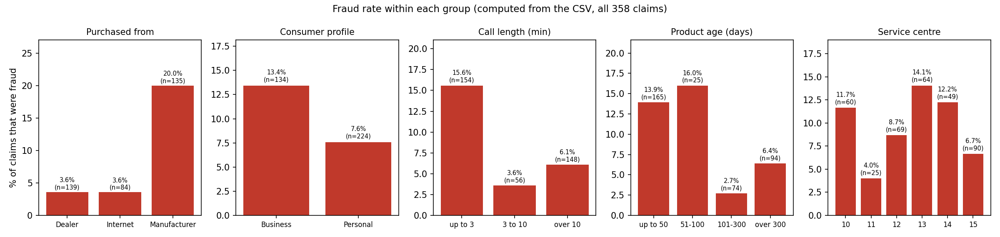
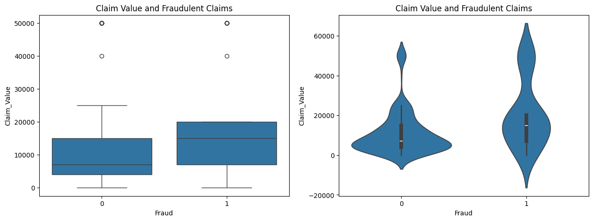
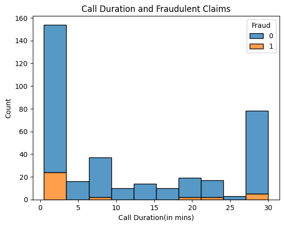
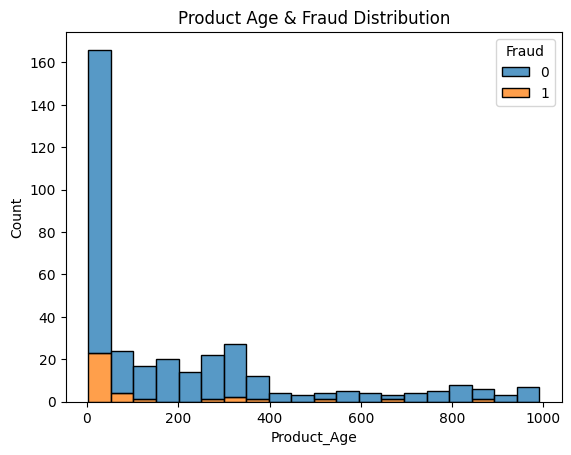
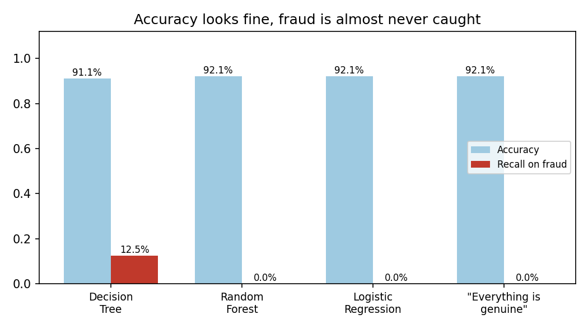
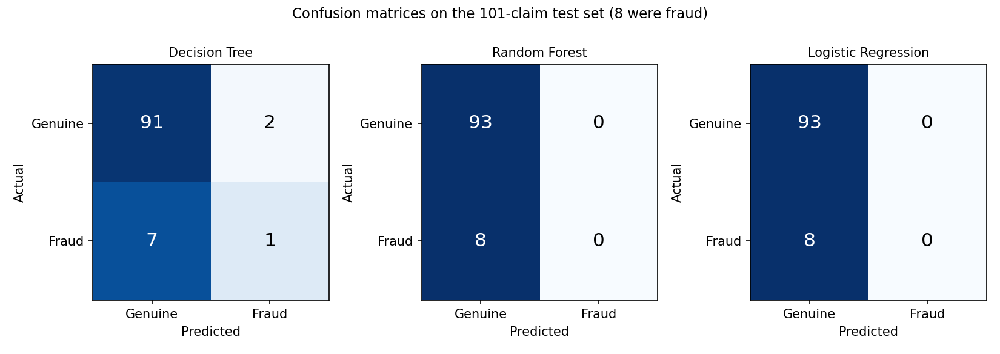
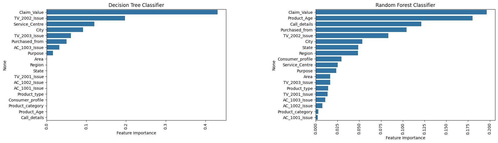

<p align="center">
  
</p>

# Warranty Claim Fraud Prediction

When a customer claims a repair or replacement under warranty, a company has to decide whether the claim is genuine. I wanted to see what separates fraudulent claims from genuine ones in a small dataset of 358 warranty claims on air conditioners and TVs in India, and whether a model could flag the fraudulent ones.

The exploratory part found some clear patterns. The fraud rate is 20% for products bought directly from the manufacturer but only 3.6% for products bought from a dealer or online, and most fraud comes in short calls to customer care, on young products, with high claim values.

The modelling part didn't work. I trained a decision tree, a random forest and logistic regression, and they all reach 91 to 92% accuracy. But only about 8% of the test claims were fraud, so predicting "genuine" every time gets 92% too. The random forest and logistic regression did exactly that, and the decision tree caught 1 of 8 frauds. I explain below what I'd change.

The longer write-up is in [REPORT.pdf](REPORT.pdf) and all of the code is in `warranty-claim-fraud-prediction-final.ipynb`.

## Dataset

Source: Kaggle, saved as `df_Clean.csv`. _Add the Kaggle link here._ It has 358 claims and 20 columns (plus an unnamed index column that I drop), no missing values and no duplicates. 35 of the 358 claims (9.8%) are fraud.

| Column | What it is |
| --- | --- |
| Region, State, Area, City | Where the claim was made (8 regions, 20 states, 27 cities, Urban or Rural) |
| Consumer_profile | Business or Personal |
| Product_category, Product_type | Household / AC or Entertainment / TV |
| AC_1001_Issue ... TV_2003_Issue | For each of six parts: 0 = no issue, 1 = repair, 2 = replacement |
| Claim_Value | Claim value in INR (0 to 50,000, median about 7,200) |
| Service_Centre | Service centre code (10 to 16) |
| Product_Age | Age of the product in days (3 to 991, median 60) |
| Purchased_from | Dealer, Manufacturer or Internet |
| Call_details | Length of the customer care call in minutes |
| Purpose | Claim, Complaint or Other |
| Fraud | 1 if the claim was fraudulent (the target) |

Two columns are redundant: all ACs are "Household" and all TVs are "Entertainment", so `Product_category` and `Product_type` say the same thing. And the three AC part columns are always 0 for TVs, and the other way round.

## What I found in the data

My notebook used count plots, which mostly show where claims are, not where fraud is likely. So I recomputed the fraud **rate** inside each group from the CSV (chart below). Here's what stands out:

- **Where it was bought is the biggest one.** 27 of the 35 frauds (77%) were products bought from the manufacturer, a fraud rate of 20.0%. For dealer and online purchases it's 3.6%.
- **Short calls.** 15.6% of claims with a call of up to 3 minutes were fraud, against about 5% for longer calls. The median call was 2.4 minutes for fraud and 7 minutes for genuine claims.
- **Young products.** The median product age is 18 days for fraud and 81 days for genuine claims. Fraud is around 14 to 16% for products up to 100 days old and under 7% after that.
- **Claim value.** The median claim is 15,000 for fraud and 7,000 for genuine claims.
- **Business customers** (13.4%) are more likely to be fraud than personal ones (7.6%), and **service centre 13** has the highest rate (14.1%).
- **Location is weak.** Urban and rural are the same (9.6% vs 10.1%). East (17.9%) and West (14.3%) have the highest rates, North West has none, but no state has more than 7 fraud cases and no city more than 5, so I wouldn't read much into the map.

<p align="center">
  
</p>

<p align="center">
  
  
  
</p>

## How it works

1. Drop the index column and turn the part-issue codes into labels (No Issue, repair, replacement).
2. Explore the data with plots against the fraud flag.
3. Remove outliers in `Claim_Value` with the 1.5 x IQR rule. This removes 24 claims (more on that below).
4. Label-encode the text columns.
5. Split 70/30 (`random_state=42`): 233 training claims and 101 test claims, of which 8 are fraud.
6. Tune a decision tree and a random forest with `GridSearchCV` (5-fold, scored by accuracy), and fit a logistic regression with default settings.
7. Evaluate on the test set.

## Results

| | Decision tree | Random forest | Logistic regression |
| --- | --- | --- | --- |
| Test accuracy | 0.911 | 0.921 | 0.921 |
| Precision (fraud) | 0.33 | 0.00 | 0.00 |
| Recall (fraud) | 0.12 | 0.00 | 0.00 |
| F1 (fraud) | 0.18 | 0.00 | 0.00 |
| Frauds found (of 8) | 1 | 0 | 0 |

<p align="center">
  
  
</p>

Predicting "genuine" for every test claim gives 93 out of 101, or 92.1%. The random forest and logistic regression scored exactly that, because they did exactly that. The decision tree found one fraud and raised two false alarms, and ends up with lower accuracy than the do-nothing baseline.

With just 8 fraud claims in the test set, one claim is worth 12.5 percentage points of recall, so these numbers are very noisy.

<p align="center">
  
</p>

For what it's worth, `Claim_Value` is the top feature in both the tree (0.43) and the forest (0.20). The forest puts `Product_Age`, `Call_details` and `Purchased_from` next, which agrees with the rates above.

<details>
<summary><b>Running it</b> (click to expand)</summary>

You need Python 3.9+ and:

```
pip install pandas numpy matplotlib seaborn scikit-learn jupyter
```

The notebook was written in Google Colab and loads the data from Google Drive:

```python
df = pd.read_csv('./drive/MyDrive/df_Clean.csv')
```

To run it locally, delete the `drive.mount` cell and change the path to `pd.read_csv('df_Clean.csv')`. The CSV is included in this repo.

The grid searches take a minute or two (2,500 and 1,280 fits). Logistic regression may print a convergence warning because the inputs aren't scaled.

</details>

## Things I'd fix or try next

- **The models don't detect fraud.** My notebook's conclusion says the models gave "excellent accuracy of 91-92%". That's the same as the do-nothing baseline of 92.1%. The conclusion does mention poor recall, but it says more data would fix it. More data helps, but the bigger changes are measuring the right thing (recall, precision, F1, PR-AUC), handling the imbalance (class weights, oversampling, a lower threshold), and using a stratified split.
- **The outlier filter removed fraud.** The IQR rule dropped 24 claims, and 8 of them (23% of all fraud) were fraud, against 5% of genuine claims. High claim values are one of the signals, so I removed the very cases I was trying to find. I wouldn't remove those outliers at all.
- **Tuning was scored on accuracy,** which rewards the "everything is genuine" model. Both grid searches picked a depth of 2, a very simple model. Then I hand-set the final tree to `max_depth=4`, which isn't what the search found. When I tried depth 2, the tree also predicted all genuine.
- **`random_state` was in the grid** as if it were a hyperparameter, which it isn't.
- **Test set too small.** 8 fraud cases is not enough to compare models. Stratified cross-validation on all 358 claims would be better.
- **Count plots vs rates.** My comments about states, cities, urban areas and product types were based on counts. "Urban has more fraud" just means urban has more claims: the rates are the same.
- **Redundant and structural columns.** Drop one of `Product_category` and `Product_type`, and think about combining the six part columns.
- **Encoding.** State, City and Region were label-encoded, so a model sees "city 21" as bigger than "city 5". One-hot or target encoding would be better, and with 358 rows I'd probably drop State and City.
- **R² and MSE don't fit.** R² is negative for all three models and MSE is just the error rate, so neither says anything useful.
- I don't know how this dataset was collected or labelled, so I wouldn't assume the patterns would hold for real claims.

## Files

```
.
├── assets/                                      # banner and plots used in this README
├── warranty-claim-fraud-prediction-final.ipynb  # the whole analysis
├── df_Clean.csv                                 # data (from Kaggle)
├── REPORT.pdf                                   # longer write-up
└── README.md
```

## Author

Yash Jain
